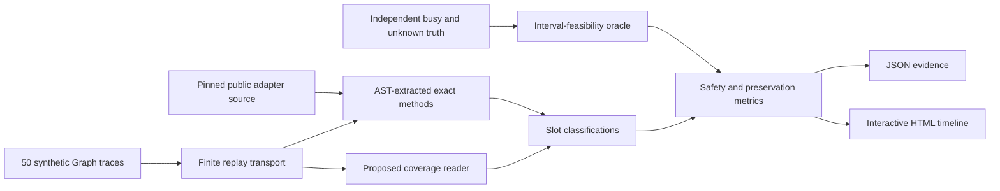

# Busy-or-Unknown Calendar Lab

Office365 calendar reads can return HTTP 200 while individual Graph batch requests fail. In the public Cal.diy adapter, that can make an unread calendar look empty to an availability caller. [Issue #30382](https://github.com/calcom/cal.diy/issues/30382) documents the failure and repro tests.

**0 / 255 unsafe slots offered with the proposed coverage policy, versus 235 / 255 with the pinned public adapter**, across 50 synthetic fixtures. All 145 legitimate slots remain available.

Node.js 22 or newer. Install once with `npm ci`, then run the one-command demo:

```sh
npm run demo
```

Captured output:

```text
Busy-or-Unknown Calendar Lab
Public Cal.diy adapter; synthetic Graph boundary; offline only.
Fixtures: 50 | candidate slots: 400
Unsafe slots: baseline 235/255 -> proposed 0/255
Legitimate availability preserved: 145/145
Error localization: 30/30 | false positives: 0
Artifacts: report.json, timeline.html
```

Open `artifacts/timeline.html` in a browser. It is self-contained: no server, CDN, account, API key or LLM. Choose `inner-503-1` and switch **Pinned baseline → Proposed fail-closed**: the same 09:00 slot changes from FREE to UNKNOWN. The independent healthy host stays free. Switch to `clean-busy-1` to see a genuinely BUSY slot. The JSON report includes actual request IDs/URLs, slot classifications, truth and localized errors for every fixture.

## Source and migration caveat

The old public Cal.com repository is now [calcom/cal.diy](https://github.com/calcom/cal.diy). Its README calls it an MIT community edition intended for personal/non-production use. **This is not the private hosted Cal.com enterprise source. These results make no claim about hosted Cal.com.**

This lab executes availability-related members from the public [Office365 CalendarService](https://github.com/calcom/cal.diy/blob/ef7954d16ab50882ca2f263c551537115b8a8bb1/packages/app-store/office365calendar/lib/CalendarService.ts), pinned at `ef7954d16ab50882ca2f263c551537115b8a8bb1`. [Provenance and SHA-256s](vendor/provenance.json) cover the unmodified source, its original test file and its [MIT notice](vendor/LICENSE).

Checked 2026-11-13: issue #30382 and linked fixes [#30383](https://github.com/calcom/cal.diy/pull/30383) and [#30389](https://github.com/calcom/cal.diy/pull/30389) were open. This is a regression pack and an independent policy comparison, **not another proposed upstream patch**, and it does not execute either pending PR.

## What's hard here

- **200 is not a coverage guarantee.** Correlate every selected calendar by ID, retain non-429 failures alongside retryable failures, and require complete pagination before offering time.
- **Unknown is not busy, and neither is free.** A failed calendar invalidates free-time claims over the entire queried host window; a different healthy host is unaffected. Blocking everything would pass safety but fail the preservation metric.
- **The oracle must not share the bug.** Independently labeled truth contains events hidden behind failed reads. Half-open interval feasibility judges offered slots, not just whether a promise rejected.

## Architecture



`src/upstream.ts` uses the TypeScript AST to extract nine exact class members, transpiles them once, and executes each case in a fresh VM context. Only the external Graph/auth setup, HTTP helper, logging, timers and randomness are substituted. The VM is an isolation aid, **not a sandbox for untrusted source**. Checksums prevent unnoticed source drift. No adapter availability algorithm is reimplemented for the baseline. The existing upstream gzip-response mock pattern and availability field-selection/filtering assertions are adapted in this project's tests; the vendored original tests are attribution/reference, not a claim that the monorepo suite ran.

The proposal tracks selected-calendar coverage through bounded 429 retries and pages. It checks missing, duplicate and unexpected response IDs, malformed values/events, outer errors, page failures and cycles. Failed coverage stays unknown. Attempts are logical replay attempts: it does not sleep for production Retry-After deadlines. This is not a drop-in production adapter.

The interval oracle and finite trace replay are small, original implementations. No shared schedule-solver or replaylab package was available in this empty repository; no employer implementation, prompts or data were imported.

## Measurement

[Fixture definitions](fixtures/README.md) describe ten families × five event positions. The variants are not 50 statistically independent failures.

| Measure                                               | Pinned baseline | Proposed policy |
| ----------------------------------------------------- | --------------: | --------------: |
| Unsafe offers / ground-truth-blocked or unknown slots |       235 / 255 |         0 / 255 |
| Legitimate slots preserved / actually free slots      |       145 / 145 |       145 / 145 |
| Exact calendar + phase + reason localization          |     Not exposed |         30 / 30 |
| Unexpected error labels                               |      Not scored |               0 |

400 candidate slots = 50 fixtures × eight half-hour slots. The denominator 255 includes 240 slots in 30 incomplete-coverage cases, plus 15 busy slots in fully read cases. The other 145 are legitimate free slots. Safety is not divided by all offers. Error localization compares exact diagnostic sets against separately authored fixture labels; healthy cases must produce no error. These are correctness counts, not performance or production incident-rate claims.

## Design decisions

See [DESIGN.md](DESIGN.md) for alternatives, interfaces, failure behavior, security, rollout and 100× scaling notes. The three key choices are executing a pinned source slice rather than a rewrite, treating completeness as explicit state, and keeping the feasibility oracle independent from adapter output.

## Verification

```sh
npm ci
npm run check
```

`check` runs formatting, strict TypeScript checking, all 85 Vitest behavior tests, then the 50-fixture demo. [CI](.github/workflows/ci.yml) defines the same checks on Node 22 and 24. CI has not been run remotely; nothing was pushed. Once dependencies are installed, tests and demo do not use network access. A clean install requires npm registry access or a populated cache.

[Evidence](evidence.md) records local and fresh-clone verification, actual demo output and browser observations. `npm run demo -- --out DIRECTORY` writes the same deterministic report elsewhere. Unknown flags fail; there is no live mode.

## Limitations

- Executes exact adapter availability members, not the full Cal.diy app. OAuth, discovery, CalendarManager's error-placeholder behavior, booking-time checks and database writes are outside the lab. An upstream end-to-end test is still required before a real fix can be certified.
- Graph is mocked. The gzip header follows the upstream test's already-decoded text response; wire compression, real throttling delays and Microsoft tenant behavior are not tested.
- Synthetic windows use UTC and two selected calendars. DST, all-day events, offset timestamps, delegated users, batches over Graph's limit and timezone conversion are not covered. Malformed event data fails closed in the proposal.
- An incomplete selected calendar blocks the whole host query window. The lab does not claim it can salvage free subranges without proof of coverage.
- The proposal is local policy code, not a merge-ready replacement for either existing upstream fix. The timeline is an offline diagnostic artifact, not a scheduling product.

## For Cal.com engineers

Use this as an adversarial input corpus alongside #30382's existing fixes, not as another troubleshooter. Port selected traces into `packages/app-store/office365calendar/lib/__tests__/CalendarService.test.ts` using the existing `requestRaw` seam. Start with mixed 429 + 503, missing response IDs, nonzero retry IDs and a failed second page. Then prove the CalendarManager error-placeholder and booking checks in the real monorepo. Keep valid empty calendars and successful pagination as negative controls so a broad fail-closed change does not erase all availability.

An engineer can inspect `artifacts/report.json` to correlate actual outgoing request IDs with each result. Re-pin deliberately, refresh hashes, and review method-set changes before rerunning on a new public revision. Do not infer hosted Cal.com status from this community-source lab.

## Roadmap

A full-monorepo regression job for the linked fix revisions; DST/all-day coverage; standards-compliant Graph retry timing; larger selected-calendar batches with request-size limits. These are not implemented here.

## License

Original lab code: MIT, copyright Goutham Madineni. Vendored public Cal.diy files retain their original MIT notice. No employer code or customer data is included.
